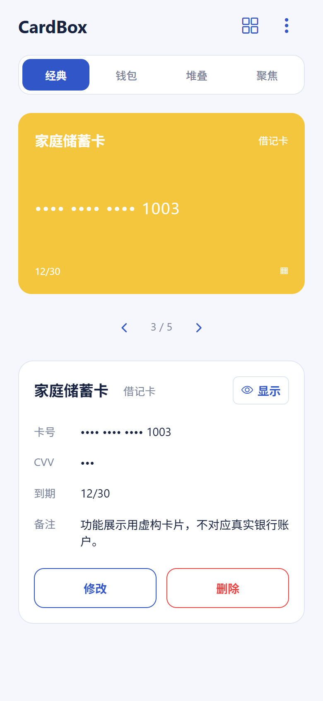
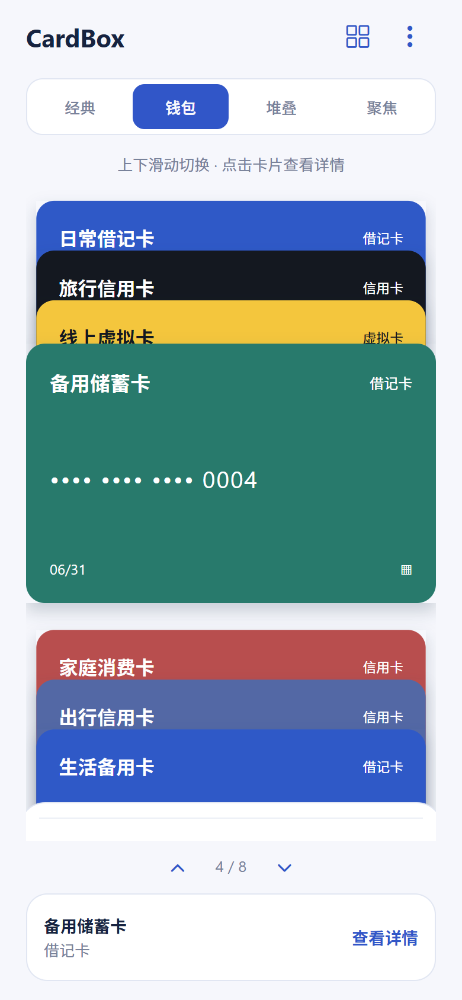
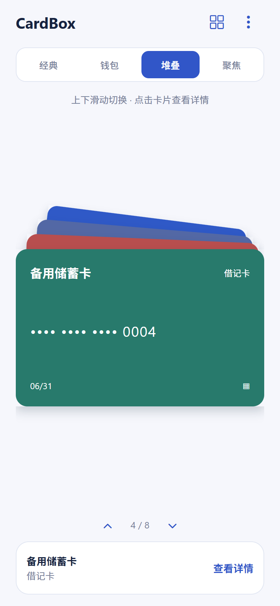
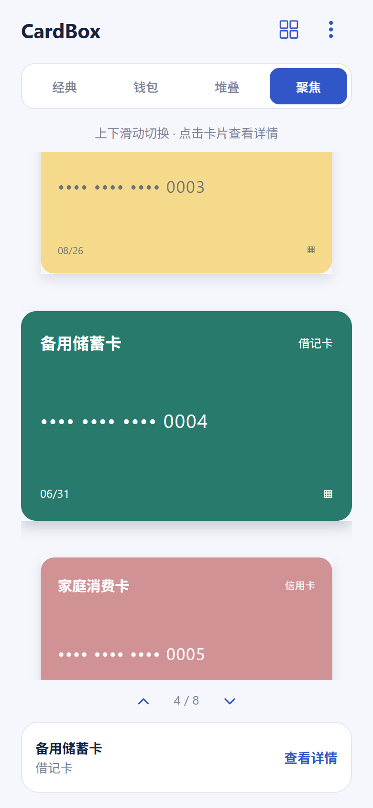

  

# CardBox

**把银行卡装进自己的数字卡包。** 无需账号，资料保存在本机，支持自定义卡面、四种浏览模式、敏感信息保护和密码加密备份。

[下载 Android APK](https://github.com/xieyanker/cardbox-mobile/releases/download/4.0.0/CardBox-4.0.0-android.apk) · [使用说明](docs/FEATURES.md) · [连接手机调试](docs/TESTING.md#连接手机) · [文档目录](docs/README.md)

## 版本与下载

| 版本                   | 状态                                 | 入口                                                                                                                                                                                         |
| ---------------------- | ------------------------------------ | -------------------------------------------------------------------------------------------------------------------------------------------------------------------------------------------- |
| **4.0.0** · 构建编号 8 | 当前 Android APK，用户已确认源码封板 | [下载安装包](https://github.com/xieyanker/cardbox-mobile/releases/download/4.0.0/CardBox-4.0.0-android.apk) · [发布说明](https://github.com/xieyanker/cardbox-mobile/releases/tag/4.0.0)     |
| **3.0.2**              | 历史 Android APK                     | [历史安装包](https://github.com/xieyanker/cardbox-mobile/releases/download/3.0.2/CardBox-3.0.2-android.apk) · [历史发布说明](https://github.com/xieyanker/cardbox-mobile/releases/tag/3.0.2) |

当前 **4.0.0** 已于 2026-10-21 经用户确认源码封板，由用户在 Expo 构建 APK 并作为 GitHub Release 附件发布。包内版本、包名、文件完整性和 v2 签名已核验，签名证书与 3.0.2 相同；独立安装及覆盖升级另待实际核验。下方功能与演示图对应 4.0.0。

仓库为私有，下载安装包时需登录有仓库访问权限的 GitHub 账号。

## 界面预览

<table>
  <tr><th>经典 · 左右切换</th><th>钱包 · 卡槽层次</th><th>堆叠 · 卡片叠放</th><th>聚焦 · 突出当前卡片</th></tr>
  <tr>
    <td></td>
    <td></td>
    <td></td>
    <td></td>
  </tr>
</table>

演示图于 2026-10-14 同步导入比较和信用卡日期后重新采集，使用 4.0.0 Web 移动视口与虚构卡片，不代表 Android 真机验收。更多页面见[功能与使用说明](docs/FEATURES.md)。

用户提供的 Android 真机照片（原图保留）

这张照片保留原始内容，不作为 4.0 验收结果。

## 主要功能

本轮新增：合并导入时逐项比较同卡号资料，选择保留当前或采用备份；信用卡可记录账单日、还款日，仅记录日期，不发送提醒。修复与兼容边界见 [4.0 开发记录](docs/CARDBOX_4.0_REQUIREMENTS.md)。

| 功能       | 可以做什么                                                                                                  |
| ---------- | ----------------------------------------------------------------------------------------------------------- |
| 卡片管理   | 添加、修改和删除借记卡、信用卡、虚拟卡；到期时间连续输入四位数字自动显示为 MM/YY；未保存修改有提示。        |
| 浏览与查找 | 四种浏览模式、名称 / 尾号搜索、类型筛选、常用卡、记住上次选卡；卡片与模式可拖动排序，卡片支持边缘自动滚动。 |
| 卡面编辑   | 选择照片、拖动裁剪、缩放、旋转、遮挡或移除图片。                                                            |
| 信息保护   | 验证后显示或复制卡号 / CVV，30 秒自动隐藏；后台锁定、照片隐私与原生屏幕保护。                               |
| 备份与恢复 | 密码加密导出，支持仅备份资料；导入预览、替换或合并，以及导入前本机恢复点。                                  |
| 显示与存储 | 跟随系统浅色 / 深色主题，查看卡面占用并清理无引用图片。                                                     |

## 开始使用

1. 下载上方已发布的 Android APK 并安装，首次打开完成系统身份验证。
2. 在右上角菜单选择“添加卡片”，再选择喜欢的浏览模式。
3. 通过“备份管理 → 导出备份”保存加密文件，换机或卸载前另存好文件和密码。

卡片字段在本机加密保存，卡面照片保存在应用私有目录、未单独加密。备份默认一起加密资料和图片；照片中的号码需自行遮挡。当前导出 v4 格式，兼容导入 v2 / v3 旧备份；旧 2.0.0 无法读取 v4。完整操作见[备份说明](docs/FEATURES.md#密码加密备份)。

Expo Go 与独立 APK 的卡包分别保存，需要通过加密备份迁移。

## 文档导航

| 想做什么                     | 从这里开始                                                    |
| ---------------------------- | ------------------------------------------------------------- |
| 了解功能和操作               | [功能与使用说明](docs/FEATURES.md)                            |
| 自己连接手机，检查 4.0       | [Android 调试与验收](docs/TESTING.md)（默认只需一个终端窗口） |
| 修改代码或构建应用           | [开发指南](docs/DEVELOPMENT.md)                               |
| 查看 4.0 完成范围和兼容要求  | [4.0 开发记录](docs/CARDBOX_4.0_REQUIREMENTS.md)              |
| 查找设计、历史版本或参考资料 | [完整文档目录](docs/README.md) · [版本变更](CHANGELOG.md)     |

技术栈：Expo SDK 54 · React Native · TypeScript · pnpm 9.12.0。作者：**xieyanker**。
