# CardBox 功能与使用说明

适用版本：**3.0.2**（Android 构建编号 7）。更新日期：2026-10-11。

[返回项目首页](../README.md) · [下载 Android APK](https://github.com/xieyanker/cardbox-mobile/releases/download/3.0.2/CardBox-3.0.2-android.apk)

CardBox 是一个资料保存在本机的数字卡包。无需创建账号，可以管理借记卡、信用卡和虚拟卡，选择不同的浏览方式，并通过密码备份迁移或恢复卡包。

本文截图来自当前 3.0.2 界面的 Web 移动视口预览，视口为 390 × 844，使用独立浏览器上下文中的虚构卡片。截图中的卡号与 CVV 未展开；没有读取用户真实卡包。系统验证和文件选择器需要在 Android 应用中操作。

## 图标与应用信息

 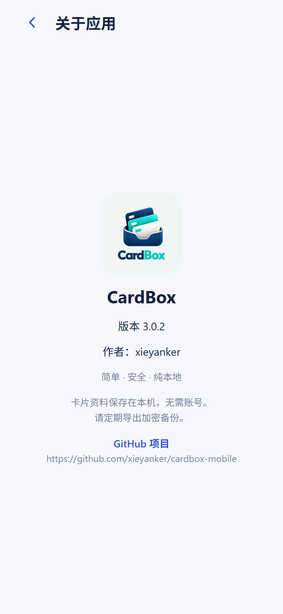

图标以卡包和叠放卡片为主体，包含 **CardBox** 字样。独立 APK 使用此图标；“关于应用”显示同一图标、版本、作者和 GitHub 项目入口。Android 自适应图标、单色主题图标和启动画面已配置，素材与设计说明见 [图标设计](design/ICON.md)。

## 首页与四种浏览模式

| 模式 | 怎么浏览 | 适合的体验 |
| --- | --- | --- |
| 经典 | 左右滑动或点击左右箭头；卡面下方直接显示卡片资料。 | 一张一张查看，并快速查看资料、修改或删除。 |
| 钱包 | 上下滑动，卡片呈卡槽分层效果；点击卡片或“查看详情”打开资料。 | 像翻看实体钱包一样选择卡片。 |
| 堆叠 | 上下滑动，多张卡片叠放；点击卡片查看详情。 | 通过卡片层次感浏览卡包。 |
| 聚焦 | 上下滑动，突出当前卡片，前后卡片作为浏览参照。 | 把注意力集中在当前选择的卡片。 |

<table>
  <tr><th>经典</th><th>钱包</th><th>堆叠</th><th>聚焦</th></tr>
  <tr>
    <td></td>
    <td></td>
    <td></td>
    <td></td>
  </tr>
</table>

默认顺序是 **经典 → 钱包 → 堆叠 → 聚焦**。切换模式后自动保存，下次打开沿用上次选择。新模式滑到第一张或最后一张时保留边界，经典模式支持循环切换。

从右上角菜单进入 **浏览模式**，使用上下箭头调整首页选项顺序，修改后自动保存；“恢复默认顺序”还原默认排列。卡片本身的顺序在“卡片排序”中单独调整。

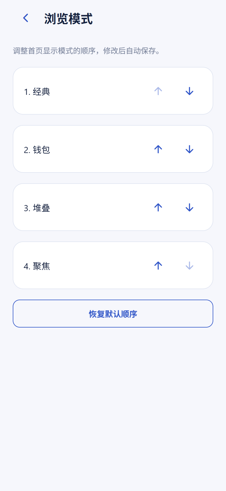

## 添加、修改与卡面

首页右上角菜单第一项为 **添加卡片**；“全部卡片”页面也保留右下角添加按钮。可以填写名称、类型、卡号、CVV、到期时间和备注，或选择本机图片作为卡面。图片按银行卡比例居中裁剪，确认预览后使用。

名称和卡号需要填写；CVV、到期时间和备注可以留空。到期时间使用 `MM/YY` 格式，例如 `12/30`。保存后自动选中新卡片。已有卡片可以从详情区点击“修改”，或点击“删除”并确认。

<table>
  <tr><th>添加卡片</th><th>查看资料</th></tr>
  <tr>
    <td>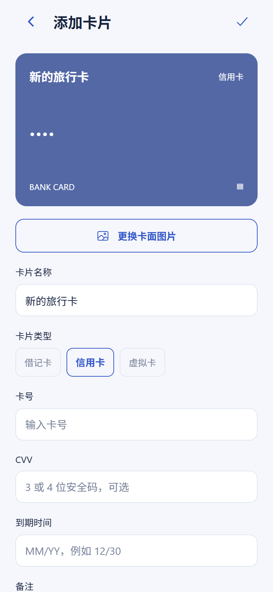</td>
    <td>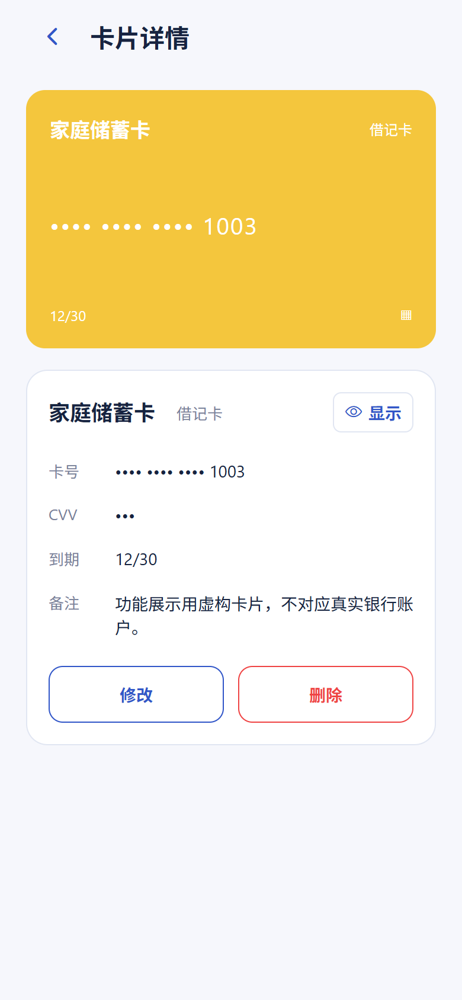</td>
  </tr>
</table>

## 全部卡片与卡片排序

点击首页右上角的网格按钮进入 **全部卡片**，通过双列卡面快速找到目标卡片；点击卡片返回首页并选中它。

菜单的 **卡片排序** 或全部卡片页面的排序入口，可打开排序列表。每张卡片旁的上下箭头用于移动位置，修改后保存，并影响首页和全部卡片的排列。

<table>
  <tr><th>全部卡片</th><th>卡片排序</th></tr>
  <tr>
    <td>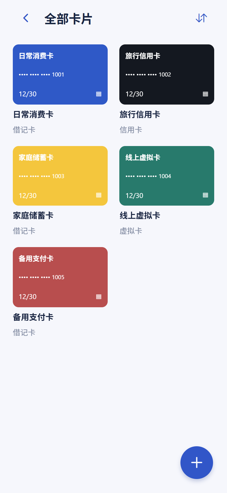</td>
    <td>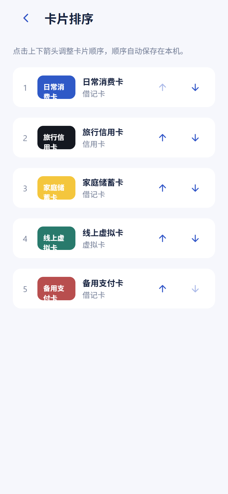</td>
  </tr>
</table>

## 菜单导航

所有菜单条目统一使用四字名称。首页通过右上角菜单添加卡片；“备份管理”点击后展开二级菜单。

| 一级菜单 | 打开的内容 |
| --- | --- |
| 添加卡片 | 新卡片表单。 |
| 卡片排序 | 调整卡片本身的顺序。 |
| 备份管理 | 二级菜单：导出备份、导入备份。 |
| 自动锁定 | 设置应用从后台返回时的锁定时机。 |
| 浏览模式 | 调整首页四种模式的排列顺序。 |
| 关于应用 | 图标、版本、作者和项目链接。 |

<table>
  <tr><th>首页菜单</th><th>备份二级菜单</th></tr>
  <tr>
    <td>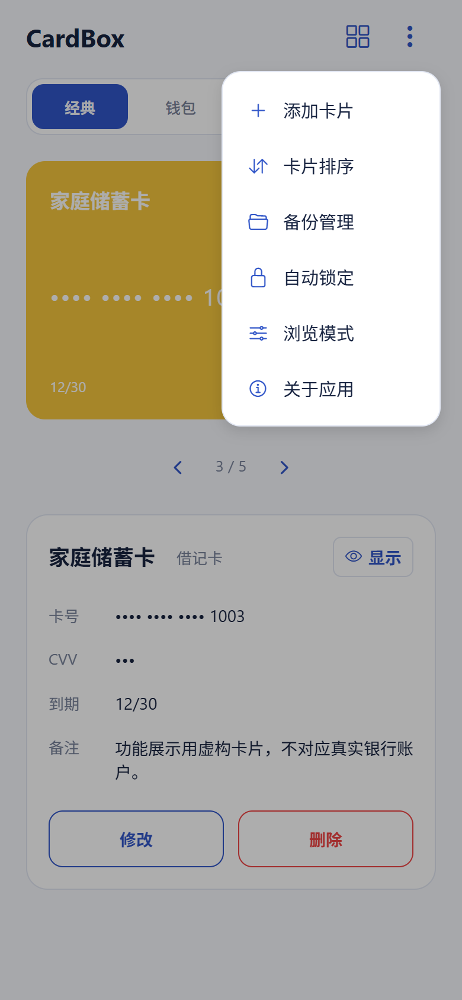</td>
    <td>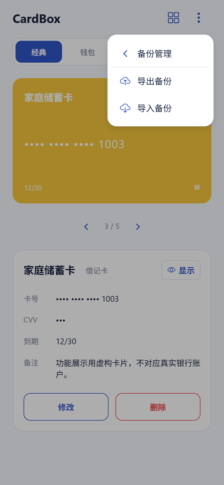</td>
  </tr>
</table>

## 密码加密备份

### 导出

进入 **备份管理 → 导出备份**，设置备份密码并选择保存位置，生成 `.cardbox` 文件。备份包含卡片资料和卡面图片，两者一起加密。请妥善保存文件与密码，密码丢失后无法恢复。

### 导入

进入 **备份管理 → 导入备份**，选择 `.cardbox` 文件、输入密码并开始导入。错误密码提前提示；正确密码和文件检查通过后，在替换确认中决定是否恢复。导入会替换整个卡包，取消确认会保留现有卡片。

<table>
  <tr><th>导出备份</th><th>导入备份</th></tr>
  <tr>
    <td>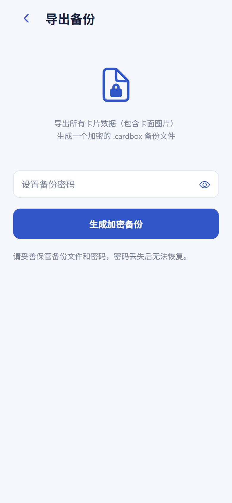</td>
    <td>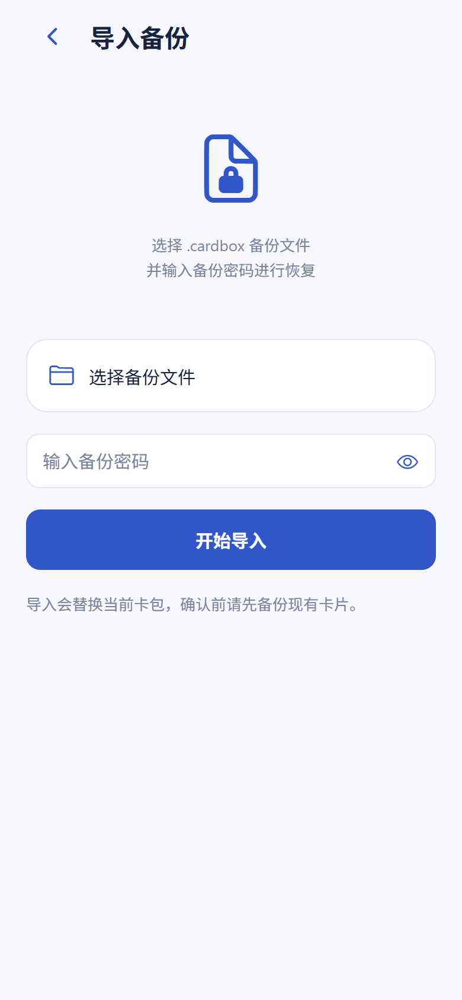</td>
  </tr>
</table>

Android 导出按钮为“选择保存位置”，截图中的 Web 预览按钮为“生成加密备份”。实际文件读写时间也受到系统文件提供器影响。备份提速已获得用户真机复测确认，测量细节见 [性能记录](performance/BACKUP_3.0.md)。

当前导出格式为 v4，支持读取旧 v2 / v3 备份；旧 2.0.0 无法导入新 v4 文件。从 Expo Go 迁移到独立 APK 时，先导出、再在新应用中导入，两者的本地卡包分别保存。

## 敏感信息与自动锁定

卡号和 CVV 默认隐藏。移动端显示敏感信息、修改、删除、导入、导出和调整自动锁定设置时，使用系统身份验证，支持设备可用的生物识别或锁屏密码。切换卡片、切换模式或进入后台时重新隐藏敏感信息。

应用切到后台后遮挡内容，返回时按设置决定是否重新验证。可选择 **立即锁定、1 分钟后锁定、5 分钟后锁定、不自动锁定**；冷启动始终需要验证身份。

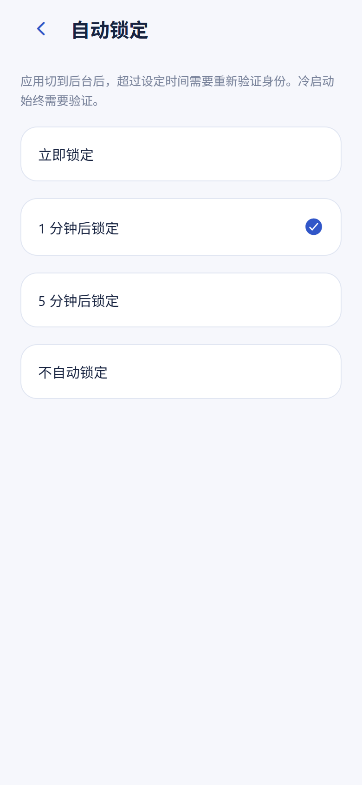

卡片字段在本机加密保存，移动端设备密钥使用系统安全存储。卡面图片保存在应用私有目录，未单独加密；照片本身含有卡号时，需自行遮挡图片中的号码。Web 预览用于界面展示，不替代移动端身份验证与存储安全验收。

## 深色主题

应用配色跟随系统浅色 / 深色主题，覆盖卡包、菜单、表单与设置页。

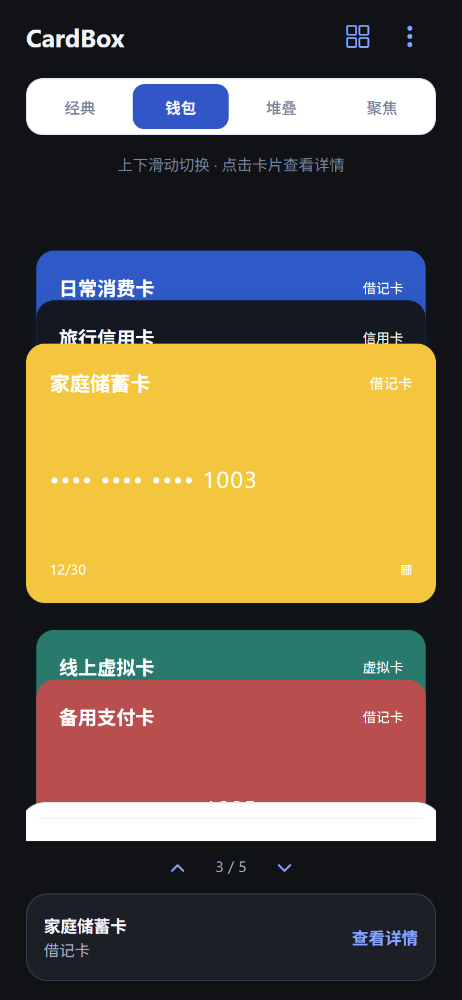

## 截图与版本记录

截图于 2026-10-11 从 `main` 的 3.0.2 页面采集。仅隐藏 Expo 的开发加载指示，不修改应用布局或功能；截图中的五张卡片通过添加表单建立，均为虚构示例。

Android APK 已通过 EAS 构建并作为 [3.0.2 Release 附件](https://github.com/xieyanker/cardbox-mobile/releases/tag/3.0.2) 发布。构建成功与完整真机验收分别记录，验收进度见 [Android 验收步骤](TESTING.md)。
