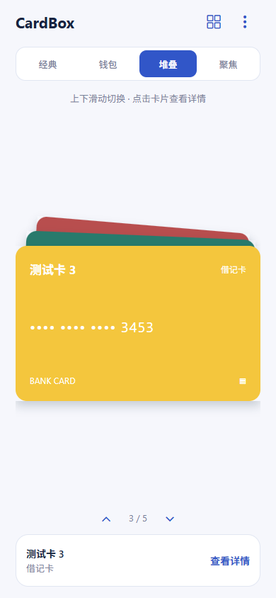
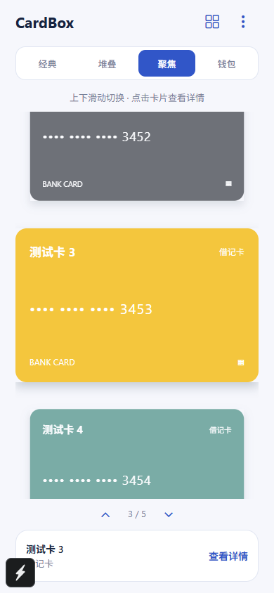
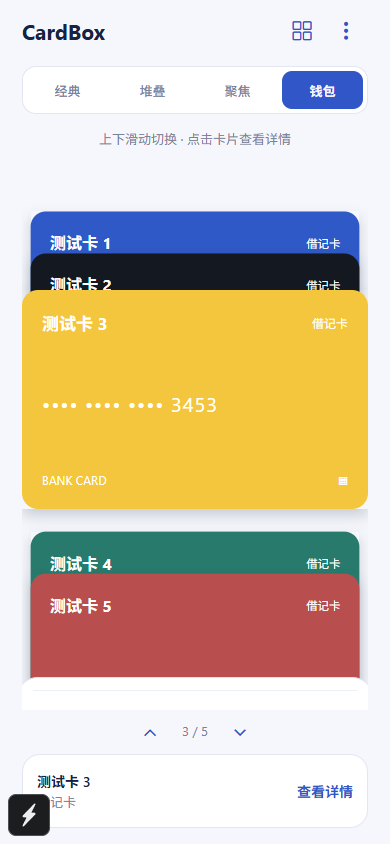

# CardBox 3.0 浏览模式

首页保留经典左右滑动与原有详情；右上角的全部卡片入口保留平铺浏览。首页新增四项模式选择，偏好保存在 `cardbox.browse.mode.v1`，重新打开应用继续使用上次模式。

默认顺序为经典 → 钱包 → 堆叠 → 聚焦。右上角菜单的“浏览模式”可通过上下箭头调整四项的位置，修改自动保存到 `cardbox.browse.order.v1`，重启后保留；可恢复默认顺序。已有模式选择保持不变；不完整或损坏的顺序配置回退到默认排列。

- 堆叠：当前卡片位于前方，后续卡片以缩放与轻微旋转露出边缘；上划向前翻卡，下划返回。
- 聚焦：当前卡片完整显示，上下邻近卡片缩小并降低透明度，突出中心卡片。
- 钱包：前面的卡片保留顶部标签，选中卡片展开，后面的卡片叠放在下方。

新模式均支持上下滑动、点击其他可见卡片选中、点击当前卡片查看详情，以及上下箭头辅助选卡。首末卡片停止在边界；经典模式仍可循环左右切换。详情页继续使用已有显示 / 隐藏、编辑和删除流程，离开详情或换卡时清除敏感字段显示状态。

参考 [ArkFlow 官方的卡包、聚焦与手势展示](https://arklab.top/)，只借鉴交互方向，不引入其资产、记账或云端功能。

动画由 Gesture Handler 手势驱动 Reanimated shared value，在原生 UI 线程计算变换，使用弹簧吸附；遵循系统减少动态效果设置。仅挂载选中卡片前后三张，避免对整个卡包逐帧重绘。手势内的卡片点击使用 Gesture Handler Pressable，等待拖动手势失败后才触发点击，防止滑动结束误选旧卡片。

## 检查

```powershell
$env:CARDBOX_TEST_URL = 'http://localhost:8082/'
pnpm test:browse
```

隔离 Chrome 验证三种模式的双向滑动、卡面点击、详情隐私、模式记忆、保留平铺 / 经典模式、首末边界、小屏以及浅 / 深色。截图与报告保存到 `.expo/cardbox-browse-artifacts/`。Web 检查不代替 Android 真机的触摸及帧率体验验收。

## Web 开发预览

以下使用虚构测试卡片，记录三种布局：

| 堆叠 | 聚焦 | 钱包 |
| --- | --- | --- |
|  |  |  |
