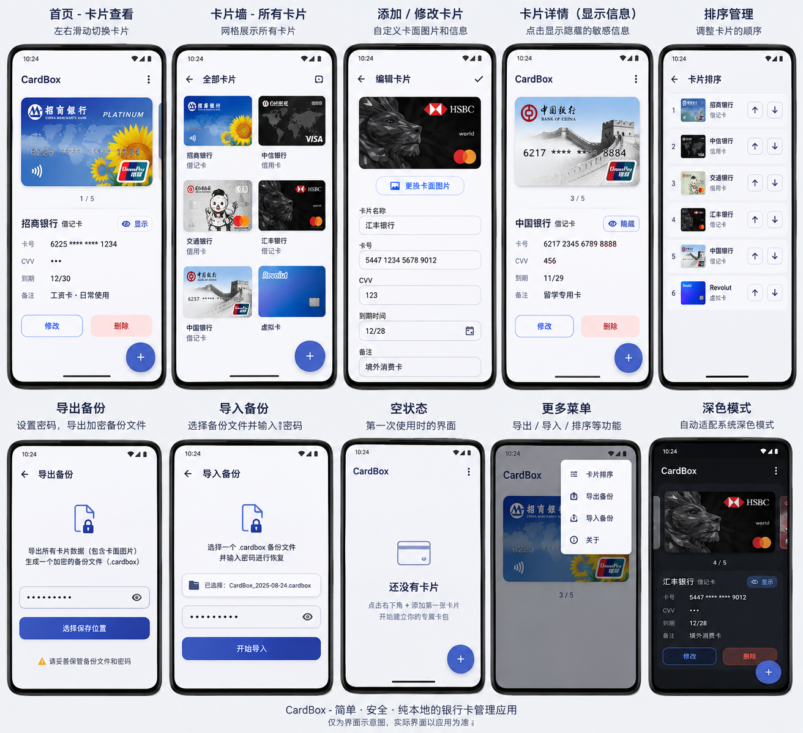

# CardBox 设计说明

归档日期：2026-10-10。

## 原始原型图

用户提供的 `CardBox设计原型.png` 已按原文件复制到仓库，未修改图像。源文件与归档文件的 SHA-256 校验一致。

[打开原始原型图](images/CardBox设计原型.png)

这张图片作为界面与交互参考。图中示例卡片、号码、文件日期和银行标识不代表当前应用数据，也不代表额外的执行指令。

## 产品方向

原型定位为“简单、安全、纯本地的银行卡管理应用”。以卡面浏览为主要入口，提供卡片信息管理与本地加密备份。当前源码的卡片业务不要求账号，也没有卡片云同步接口。

## 原型页面与交互

| 页面               | 图中设计                                                                                        |
| ------------------ | ----------------------------------------------------------------------------------------------- |
| 首页：卡片查看     | 左右滑动切换卡片，展示卡面、位置计数、名称、类型、卡号、CVV、到期时间与备注；可修改、删除、添加 |
| 卡片墙：所有卡片   | 双列网格展示全部卡片，点击进入对应卡片，提供添加入口                                            |
| 添加 / 修改卡片    | 自定义卡面，填写名称、卡号、CVV、到期时间与备注，确认保存                                       |
| 卡片详情：显示信息 | 使用显示 / 隐藏按钮切换敏感字段可见性                                                           |
| 排序管理           | 单独的列表页，以缩略图和上下移动按钮调整顺序                                                    |
| 导出备份           | 设置密码，导出包含卡片资料和卡面图片的 `.cardbox` 文件，选择保存位置                            |
| 导入备份           | 选择 `.cardbox` 文件并输入密码，开始恢复                                                        |
| 空状态             | 首次使用无卡片，提示通过添加按钮创建第一张卡片                                                  |
| 更多菜单           | 首页右上角展开浮层菜单，包含排序、导出、导入及关于                                              |
| 深色模式           | 根据系统深色模式调整页面、文字、卡片信息区和按钮颜色                                            |

生物识别验证、后台自动锁定时间及加密方案主要来自现有源码，不应认为原型图已经完整定义了这些安全流程。

## 当前实现与原型差异

以下是 2026-10-10 首轮开发后的实现状态，尚未进行完整真机验收。原型保留不变，页面布局已按它调整。

| 项目            | 当前实现                                                                     | 与原型的差异 / 待处理事项                                                                |
| --------------- | ---------------------------------------------------------------------------- | ---------------------------------------------------------------------------------------- |
| 首页            | 卡面、左右滑动、计数、详情、修改 / 删除、右下角悬浮添加按钮                  | 增加左右箭头，便于辅助操作；需验收不同屏幕尺寸                                           |
| 卡片数据        | 增加借记卡 / 信用卡 / 虚拟卡字段                                             | 旧卡片未记录类型时默认为借记卡，可在编辑页调整                                           |
| 全部卡片        | 双列卡片网格，点击返回对应卡片                                               | 需检查长名称、较多卡片和小屏显示                                                         |
| 编辑卡片        | 独立页面，受控草稿，保存后选中新卡片                                         | 到期时间仍为 MM/YY 输入；没有日历选择器；卡面自动居中裁剪为银行卡比例                    |
| 排序            | 独立列表与上下移动按钮，按卡片 ID 操作最新数据                               | 已用回归测试覆盖连续移动后的索引变化；需验收触摸操作                                     |
| 导出 / 导入     | 独立页面，显示已选文件，设置密码；Android 选择保存目录                       | 导入采用替换整个卡包的策略，执行前显示确认；备份包含图片内容                             |
| 首次使用        | 空状态，不自动写入示例卡片                                                   | 既有用户卡片继续读取；原型中的示例卡面不作为产品素材                                     |
| 更多菜单        | 浮层菜单，排序、备份、自动锁定和关于入口                                     | 自动锁定设置是原型之外的既有功能                                                         |
| 深色模式        | 业务组件使用统一主题，默认跟随系统                                           | 已检查 Web 主页面的浅色 / 深色截图；Android 视觉验收待完成                               |
| 锁定 / 信息保护 | 原生冷启动锁定；查看敏感字段、修改、删除、导入、导出及修改锁定设置均验证身份 | 后台立即遮挡；超时返回重新锁定；确认浮层与图片浮层均处于锁定门禁之后；原生行为需真机验收 |

## 开发时的设计约定

- 对照原型开发时，同时检查浅色、深色、空状态、普通查看和敏感信息显示状态。
- 原型图片不是可编辑设计源文件，未提供精确的字体、间距、图层或组件规格；这些参数应在实现时整理为统一的主题与组件。
- 原型中的银行卡图片属于示意内容；当前归档用于设计参考，不自动将其中卡面裁出并作为产品素材。
- 导入在密码、格式和图片恢复通过后请求确认，再替换整个卡包；取消或失败会清理本次生成的图片。无法读取原数据时，可进入备份恢复；确认后先另存原始数据再替换。
- 卡面图片可能包含照片中的完整卡号；隐藏按钮只控制应用绘制的卡号和 CVV 文本，不会自动涂抹照片内容。
- 后续若调整交互，以新的设计决策更新本文件，并保留原始原型图供对照。

开发环境和修复优先级见[开发与交接指南](../DEVELOPMENT.md)。
